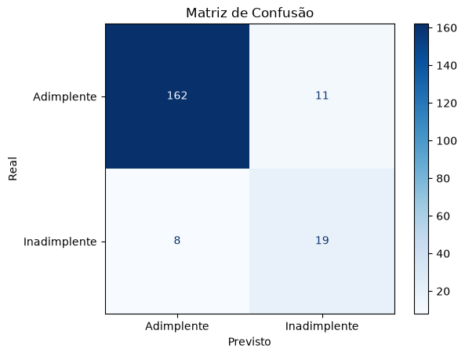
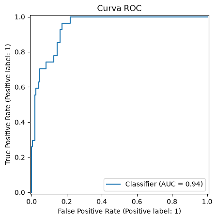

# Relatório Técnico — Motor de Classificação e Decisão Automática

**Proposta 5 — Machine Learning & Chatbot (Projeto Tech 2026)**

Integrantes:
- Fabio Douglas dos Santos Filho — RA 160787
- João Victor Araujo Silva — RA 158725
- Guilherme Moreira Frauches Souza — RA 148960

## 1. Objetivo

Classificar solicitações de crédito como **aprovado** ou **negado** a partir do risco de inadimplência e retornar a probabilidade da decisão. Quando a confiança do modelo for menor que 70%, o Back-End encaminha a solicitação para aprovação manual do administrador.

## 2. Dataset

- 1.000 registros simulados (`data/gerar_dataset.py`, semente fixa 42).
- Variáveis explicativas: `idade`, `renda_mensal`, `valor_solicitado`, `num_parcelas`, `atrasos_anteriores`, `tempo_emprego_meses`.
- Alvo: `inadimplente` (0 = adimplente, 1 = inadimplente).
- Distribuição: 867 adimplentes (86,7%) e 133 inadimplentes (13,3%).

## 3. Pipeline

1. Divisão treino/teste 80/20 estratificada.
2. `StandardScaler` para padronização das features.
3. `RandomForestClassifier` (200 árvores, profundidade máxima 8, `class_weight="balanced"` para compensar o desbalanceamento).
4. Exportação do pipeline completo em `model/modelo.joblib`.

## 4. Resultados (conjunto de teste, 200 registros)

| Métrica  | Valor  |
|----------|--------|
| Acurácia | 0,905  |
| Precisão | 0,633  |
| Recall   | 0,704  |
| F1-score | 0,667  |
| AUC      | 0,945  |

### Matriz de Confusão



|                         | Previsto Adimplente | Previsto Inadimplente |
|-------------------------|---------------------|-----------------------|
| **Real Adimplente**     | 162 (VN)            | 11 (FP)               |
| **Real Inadimplente**   | 8 (FN)              | 19 (VP)               |

### Curva ROC



A AUC de 0,945 mostra que o modelo separa bem as duas classes em diferentes limiares.

## 5. Custo de Falsos Positivos vs. Falsos Negativos

**Falso Positivo (11 casos):** um bom pagador é classificado como inadimplente e tem o crédito negado. O custo é a perda de receita e a insatisfação do cliente, mas não há prejuízo direto.

**Falso Negativo (8 casos):** um inadimplente é classificado como bom pagador e recebe o crédito. O custo é o valor emprestado que não retorna, o que gera prejuízo financeiro direto.

Como o falso negativo custa mais, o modelo foi treinado com `class_weight="balanced"`. Comparado ao treino sem balanceamento, os falsos negativos caíram de 11 para 8 e os falsos positivos subiram de 5 para 11. A acurácia caiu levemente (0,920 → 0,905), mas o recall dos inadimplentes subiu de 0,593 para 0,704, que é a troca desejada para o negócio.

## 6. Limiar de Decisão

A API retorna a classe com maior probabilidade. Se essa probabilidade for menor que **0,70**, o campo `aprovacao_manual` vem como `true` e o Back-End exige a revisão do administrador. Assim, os casos em que o modelo está em dúvida, onde se concentram a maioria dos erros, passam por uma pessoa antes da decisão final.

## 7. API

`POST /predict`

Entrada:
```json
{
  "idade": 45,
  "renda_mensal": 9000,
  "valor_solicitado": 3000,
  "num_parcelas": 24,
  "atrasos_anteriores": 0,
  "tempo_emprego_meses": 120
}
```

Saída:
```json
{
  "classe": "aprovado",
  "probabilidade": 0.9887,
  "aprovacao_manual": false
}
```

## 8. Testes

`tests/test_app.py` simula requisições ao microsserviço com o `TestClient` do FastAPI e valida o health check, o formato da resposta, a classificação de um bom e de um mau pagador, a regra do limiar e a rejeição de payload inválido. Resultado: 6 testes aprovados.
